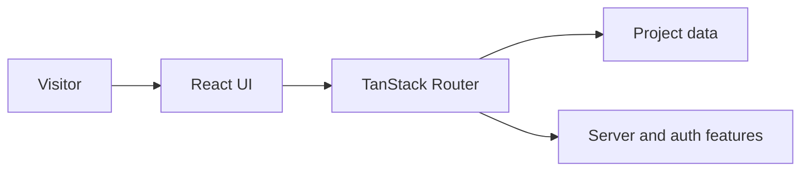

# AI Engineering Portfolio

A personal portfolio showcasing AI projects, skills and experience. Built with React, TypeScript, Vite and TanStack Router.

## Run locally

Use a recent Node.js release supporting TypeScript stripping (22.13+).

```bash
npm ci
npm run dev
```

## Quality checks

```bash
npm run typecheck
npm run lint
npm test
npm run check:auth
```

`npm run build` also runs database migrations; configure the target database first. Review `scripts/with-app-env.mjs` for environment setup.

## Selected AI projects

- [JobHunt](https://github.com/dheerajbhukya7/JOBHUNT): AI job-search automation.
- [Multi-Agent Research System](https://github.com/dheerajbhukya7/Multi-Agent-Research-System): research orchestration.
- [RAG Book Assistant](https://github.com/dheerajbhukya7/RAG-BOOK-ASSISTANT): PDF question answering.
- [City Intelligence Agent](https://github.com/dheerajbhukya7/city-intelligence-agent): external data tools.

See [redesign notes](REDESIGN-NOTES.md) for UI changes. Never commit credentials.

## Repository overview

AI engineering portfolio showcasing Generative AI, RAG, agentic systems and full-stack projects.

**Suggested GitHub topics:** `ai-engineering` `portfolio` `react` `typescript` `vite` `tanstack-router` `generative-ai`.

## System architecture


